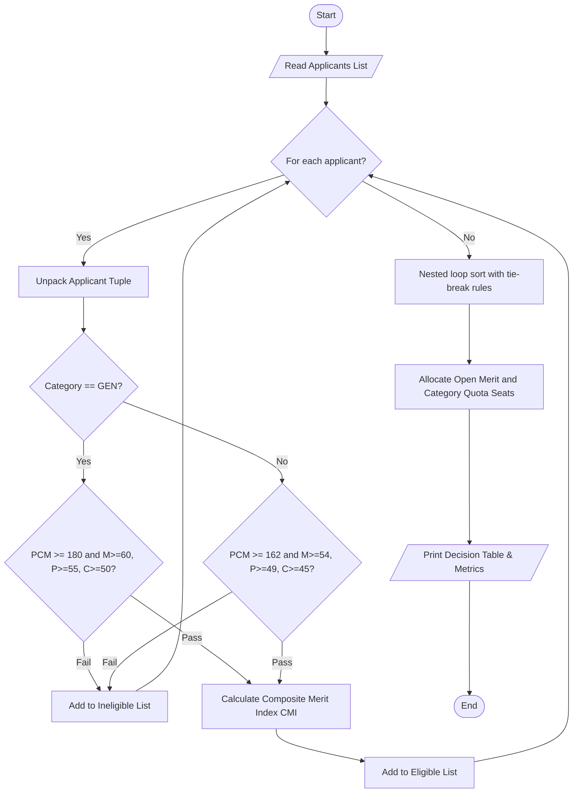

# Case Study 20: University Admission Decision Program

## 1. Problem Statement
This program checks applications for an engineering university. It uses each student's Mathematics, Physics and Chemistry marks, entrance exam rank, category (`GEN`, `OBC`, `SC` or `ST`), and interview score.

First, it checks whether the student meets the required cutoffs. For eligible students, it calculates a Composite Merit Index (CMI) and sorts the students by merit. Then it assigns open and reserved seats.

## 2. Objectives
- Store the applicant details in tuples and read them using tuple unpacking.
- Check the subject marks and total marks against the cutoffs.
- Give reserved categories lower cutoffs.
- Calculate a CMI using marks, entrance rank and interview score.
- Sort eligible students and use the given tie-break rules when CMI scores match.
- Assign the available open and reserved seats.
- Use the programming concepts required for this case study, such as variables, conditions, loops, lists and tuples.

---

## 3. Assumptions
- Each applicant is stored as a tuple in this order: `(applicant_id, name, math, physics, chemistry, entrance_rank, category, interview)`.
- Subject marks are from 0 to 100. Interview scores are from 0 to 25. Entrance ranks are from 1 to 10,000. A smaller rank number is better.
- The GEN cutoffs are: total PCM marks at least 180, Mathematics at least 60, Physics at least 55 and Chemistry at least 50.
- The OBC, SC and ST cutoffs are: total PCM marks at least 162, Mathematics at least 54, Physics at least 49 and Chemistry at least 45.
- Students are sorted using these rules, in order:
  1. Higher CMI score.
  2. Higher Mathematics score.
  3. Higher Physics score.
  4. Higher interview score.
  5. Lower entrance rank.

---

## 4. Algorithm
- **Step 1:** Put the applicant records in a list of tuples.
- **Step 2:** Set the seat numbers: `TOTAL_SEATS = 3`, `CATEGORY_RESERVED_SEATS = 1` and `OPEN_SEATS = 2`.
- **Step 3:** Check each applicant's marks against the cutoffs for their category. Save eligible students in one list and save ineligible students with a reason in another list.
- **Step 4:** For each eligible student, calculate:
  - `PCM_Percentage = (math + physics + chemistry) / 3.0`
  - `Normalized_Rank = (10000 - rank) / 100.0`
  - `Normalized_Interview = (interview / 25.0) * 100.0`
  - `CMI = (PCM_Percentage * 0.50) + (Normalized_Rank * 0.30) + (Normalized_Interview * 0.20)`
- **Step 5:** Sort the eligible list with nested loops. Compare CMI first, then Mathematics, Physics, interview score and entrance rank. Swap two students when the one later in the list has the better result.
- **Step 6:** Give the first two students open seats. Then give one reserved seat to the next eligible student in a reserved category, if there is one. Mark the other eligible students as waitlisted.
- **Step 7:** Print the decision table and totals.

---

## 5. Flowchart


---

## 6. Pseudocode
```text
BEGIN UniversityAdmissionEngine
    INITIALIZE applicants list
    SET TOTAL_SEATS = 3
    SET CATEGORY_SEATS = 1
    SET OPEN_SEATS = TOTAL_SEATS - CATEGORY_SEATS

    FOR EACH (id, name, m, p, c, rk, cat, intv) IN applicants:
        pcm = m + p + c
        IF cat == "GEN" THEN
            min_pcm = 180, min_m = 60, min_p = 55, min_c = 50
        ELSE
            min_pcm = 162, min_m = 54, min_p = 49, min_c = 45
        END IF

        IF pcm >= min_pcm AND m >= min_m AND p >= min_p AND c >= min_c THEN
            pcm_pct = pcm / 3.0
            norm_rank = (10000 - rk) / 100.0
            norm_intv = (intv / 25.0) * 100.0
            cmi = ROUND((pcm_pct * 0.50) + (norm_rank * 0.30) + (norm_intv * 0.20), 2)
            APPEND (cmi, m, p, intv, 10000 - rk, id, name, cat, pcm, rk) TO eligible_list
        ELSE
            APPEND (id, name, cat, reason) TO ineligible_list
        END IF
    END FOR

    // Sort by CMI, then Math, Physics, interview score and entrance rank
    FOR i FROM 0 TO LENGTH(eligible_list) - 2:
        FOR j FROM 0 TO LENGTH(eligible_list) - i - 2:
            IF eligible_list[j+1] has the better result based on the tie-break rules THEN
                SWAP eligible_list[j], eligible_list[j+1]
            END IF
        END FOR
    END FOR

    // Quota Allocation
    FOR EACH candidate IN eligible_list:
        IF open_count < OPEN_SEATS THEN
            status = "ADMITTED (Open Merit)"
            open_count = open_count + 1
        ELSE IF candidate.cat != "GEN" AND cat_count < CATEGORY_SEATS THEN
            status = "ADMITTED (Category Quota: " + candidate.cat + ")"
            cat_count = cat_count + 1
        ELSE
            status = "WAITLISTED"
        END IF
        RECORD decision
    END FOR

    PRINT decision table and metrics
END
```

---

## 7. Python Source Code
The full program is in `solution.py` in this folder.

```python
# See solution.py for the complete program.
```

---

## 8. Test Cases

### Test Case 1: Checking the tie-break rules
- **Inputs:**
  - `APP101`: Aarav Sharma (`GEN`, M: 88, P: 82, C: 75, Rank: 450, Interview: 22)
  - `APP103`: Chirag Verma (`GEN`, M: 92, P: 78, C: 75, Rank: 450, Interview: 22)
  - `APP105`: Divya Nair (`GEN`, M: 88, P: 82, C: 75, Rank: 450, Interview: 22)
- **Expected outcome:**
  - All three have a CMI of 87.08.
  - `APP103` is first because their Mathematics mark is higher.
  - `APP101` and `APP105` have the same marks and rank, so their original order stays the same. `APP101` gets the second open seat and `APP105` is waitlisted.

### Test Case 2: Checking the reserved-category cutoffs
- **Inputs:**
  - `APP102`: Bhavna Patel (`OBC`, M: 65, P: 58, C: 52, Rank: 1200, Interview: 20) $\rightarrow$ PCM = 175.
  - `APP104`: Deepak Rao (`SC`, M: 48, P: 50, C: 42, Rank: 3500, Interview: 15) $\rightarrow$ PCM = 140.
- **Expected outcome:**
  - If these two applicants are tested on their own, `APP102` meets the reserved-category cutoffs because their PCM total is 175 and can get the reserved seat.
  - `APP104` is not eligible because their PCM total is 140, which is below 162.

---

## 9. Output & Execution Log
```text
======================================================================
       UNIVERSITY ADMISSION DECISION ENGINE (Case Study 20)
======================================================================
[Loading Predefined Evaluation Dataset (6 Applicants)...]

----------------------------------------------------------------------
STAGE 1: ELIGIBILITY VERIFICATION
----------------------------------------------------------------------
  [ELIGIBLE]   APP101 - Aarav Sharma (GEN) | PCM: 245 | CMI: 87.08
  [ELIGIBLE]   APP102 - Bhavna Patel (OBC) | PCM: 175 | CMI: 71.57
  [ELIGIBLE]   APP103 - Chirag Verma (GEN) | PCM: 245 | CMI: 87.08
  [INELIGIBLE] APP104 - Deepak Rao (SC) | Reason: PCM aggregate 140 below cutoff (162.0)
  [ELIGIBLE]   APP105 - Divya Nair (GEN) | PCM: 245 | CMI: 87.08
  [ELIGIBLE]   APP106 - Esha Reddy (OBC) | PCM: 204 | CMI: 80.8

----------------------------------------------------------------------
STAGE 2: MULTI-CRITERIA TIE-BREAKING & MERIT RANKING
----------------------------------------------------------------------
Merit Ranking after Tie-Breaking:
  Rank 1: APP103 | Chirag Verma | Category: GEN | CMI: 87.08 [M:92, P:78, Rank:450]
  Rank 2: APP101 | Aarav Sharma | Category: GEN | CMI: 87.08 [M:88, P:82, Rank:450]
  Rank 3: APP105 | Divya Nair | Category: GEN | CMI: 87.08 [M:88, P:82, Rank:450]
  Rank 4: APP106 | Esha Reddy | Category: OBC | CMI: 80.8 [M:72, P:68, Rank:800]
  Rank 5: APP102 | Bhavna Patel | Category: OBC | CMI: 71.57 [M:65, P:58, Rank:1200]

----------------------------------------------------------------------
STAGE 3: SEAT ALLOCATION (Open Merit & Category Quota)
----------------------------------------------------------------------

======================================================================
FINAL UNIVERSITY ADMISSION DECISION SHEET
======================================================================
App ID   Candidate Name     Cat    CMI      Admission Decision
----------------------------------------------------------------------
APP103   Chirag Verma       GEN    87.08    ADMITTED (Open Merit)
APP101   Aarav Sharma       GEN    87.08    ADMITTED (Open Merit)
APP105   Divya Nair         GEN    87.08    WAITLISTED
APP106   Esha Reddy         OBC    80.80    ADMITTED (Category Quota: OBC)
APP102   Bhavna Patel       OBC    71.57    WAITLISTED
APP104   Deepak Rao         SC     N/A      REJECTED (PCM aggregate 140 below cutoff (162.0))
======================================================================
Total Processed: 6 | Eligible: 5 | Ineligible: 1
Total Admitted: 3 / 3 seats
======================================================================
```

---

## 10. Conclusion
This case study uses marks, entrance rank and interview scores to make an admission list. The program checks the cutoffs, works out each eligible student's CMI, sorts the list and assigns the seats. It uses tuples, lists, conditions and loops to do these steps.
